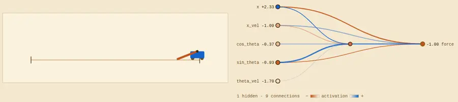
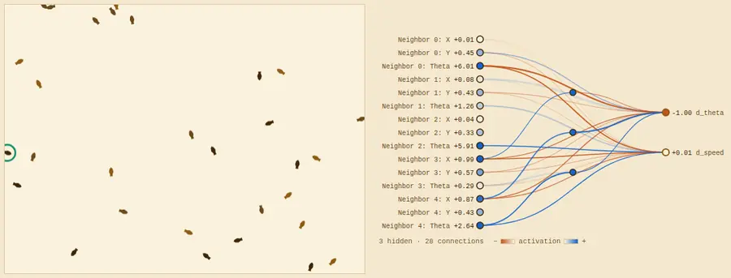
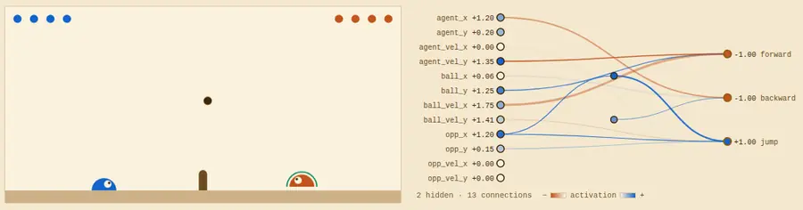
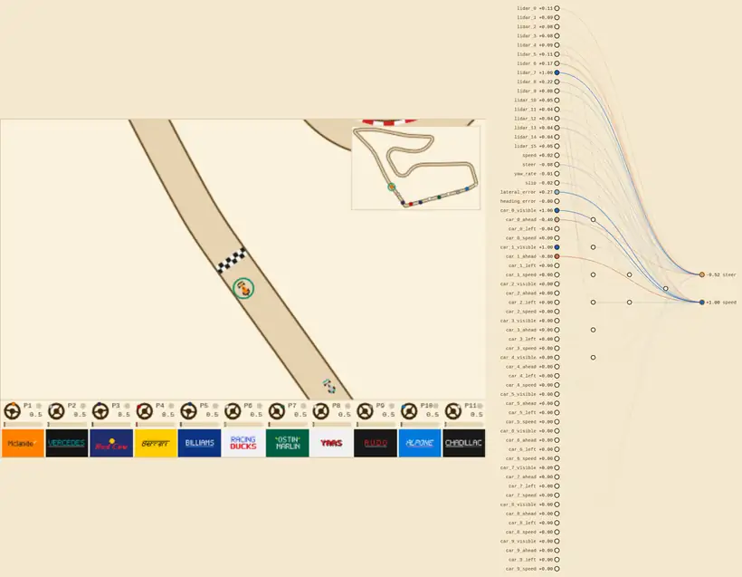
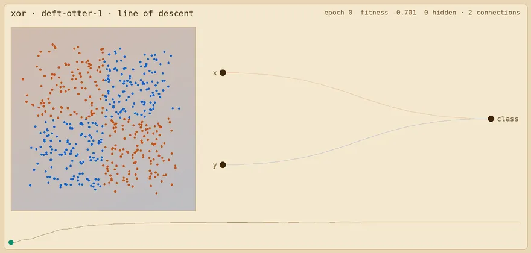
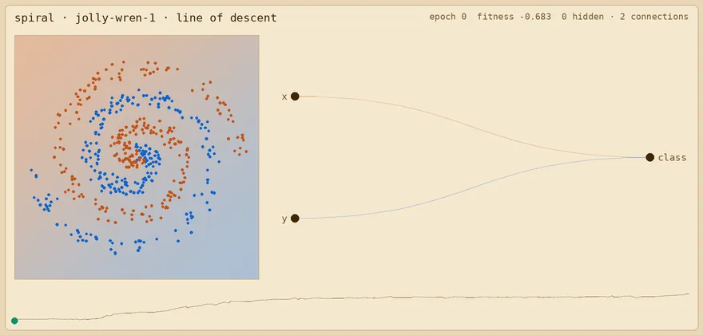

# turbo-neat


**turbo-neat** is a hardware-accelerated implementation of the 2002 paper [NEAT](http://nn.cs.utexas.edu/downloads/papers/stanley.ec02.pdf) (NeuroEvolution of Augmenting Topologies) in JAX. This project also includes a variety of examples spanning from classic RL tasks to fun multi-agent examples -- evolve agents to race cars or play volleyball through self-play!

NEAT is an evolutionary algorithm that evolves a population of tiny neural networks at the neuron-level against an environment.

One epoch of the NEAT algorithm works as follows:
1. Evaluation: compute the fitness of each member of the population by running environment rollouts
2. Speciation: cluster the population into groups, or 'species' -- this is a tunable mechanism that protects nascent innovation
3. Reproduction: build the next generation of the population by combining features of high-performing members within each species
4. Mutation: apply small weight perturbations or add/remove nodes at random to the new population members

This algorithm converges to efficient, accurate models across a variety of toy tasks, from learning simple functions against noisy data, to classic RL control tasks like cart-pole, and even extending to multi-player games like slimevolley and F1 racing where the agents are evolved through self-play.

When supplied with a vectorizable environment, **turbo-neat** runs the NEAT algorithm performantly end-to-end in parallel on a GPU.


## Quickstart

### 1. Installation
To install python dependencies with uv, run:
```bash
./install.sh
```
This will detect if a NVIDIA GPU is present on your machine and install the JAX CUDA extras if they are needed.

### 1. Pick an environment

turbo-neat plays any environment with the familiar batched `reset` and `step` interface.

You can find example environments in the [EvoJAX](https://github.com/google/evojax) project. 

For this example we'll use their [cartpole environment](https://github.com/google/evojax/blob/main/evojax/task/cartpole.py).

```python
import jax
import jax.numpy as jnp
from evojax.task.cartpole import CartPoleSwingUp

env = CartPoleSwingUp()
```

### 2. Configure NEAT

NEAT is configurable in a variety of ways that are documented in code. I recommend starting with the example defaults.

```python
import neat.activations as act
from neat.config import GenomeConfig, MutationConfig, NEATConfig, SelectionConfig
from neat.species import make_improvement_stagnation_fn

config = NEATConfig(
    genome_config=GenomeConfig(
        input_size=env.obs_shape[0],
        output_size=env.act_shape[0],
        initial_capacity=50,  # nodes per genome; grows when it fills up
        init_weight_mean=0.0,
        init_weight_std=1.0,
        activation_fns=[act.iden, act.tanh, act.relu],  # for hidden nodes
        input_activation=act.iden,  # one for every input, or a list of one per input
        output_activation=act.tanh,
        init_mode="full",  # start with every input connected to every output
    ),
    mutation_config=MutationConfig(
        add_connection_prob=0.1,
        disable_connection_prob=0.05,
        add_node_prob=0.05,
        disable_node_prob=0.03,
        mutate_weight_prob=0.8,
        mutate_weight_std=0.1,
        mutate_activation_prob=0.0,
        mutate_bias_prob=0.1,
        mutate_bias_std=0.1,
    ),
    selection_config=SelectionConfig(
        population_size=256,
        cutoff_pct=0.1,  # the worst 10% of each species (rounded down) can't be parents
        compatibility_coefficients=(1.0, 0.5),  # species distance: topology, weights
        stagnation_fn=make_improvement_stagnation_fn(max_stagnated_steps=20),
    ),
)
```

### 3. Running NEAT

A fitness function scores every genome in the population at once. `make_fitness_fn` builds one from an environment. 

In some cases it's useful to run periodic evaluations as well, these could be configured differently to have longer rollouts than are feasible for training or pit the best agents against one-another in multi-agent setttings. Use `test_fn` to customize this behavior. You can find custom test function implementations for multi-agent etc in `examples/`.

```python
from neat.fitness import make_fitness_fn, make_test_fn
from neat.neat import NEAT
from neat.testing import make_top_k_test

neat = NEAT(
    config,
    # each genome's fitness: its mean total reward over 16 episodes of 1000 steps,
    # all genomes playing from the same 16 random starting RNG
    fitness_fn=make_fitness_fn(
        env, num_steps=1000, num_episodes=16, replicate_rng=True
    ),
    # the 10 fittest each play 100 new episodes
    test_fn=make_top_k_test(make_test_fn(env, num_steps=1000, num_episodes=100)),
)
population = neat.run(seed=0, num_generations=50)
```
`run` returns the final population. Its last scored generation is `prev_batched_genome`; `batched_genome` holds that generation's unscored offspring.

```python
from neat.genome import forward, prepare_for_inference

scored = population.prev_batched_genome
best = jax.tree.map(lambda x: x[jnp.argmax(scored.fitness)], scored)
best = prepare_for_inference(best)  # sort the graph for the forward pass

state = env.reset(jax.random.split(jax.random.PRNGKey(0), 1))
actions = forward(
    best, state.obs, activation_selector=config.genome_config.activation_selector
)
state, rewards, done = env.step(state, actions)
```

### 4. Launch and Monitor


To watch a run in the dashboard, pass `monitor=Monitor(project="cartpole")` to `NEAT` and an `episode_fn` to `run` that packs the environment's states into an `Episode`, drawn by a renderer you add to `RENDERERS` in `monitor/static/renderers.js` (see [Monitoring runs](#monitoring-runs)).

## Monitoring runs
A comprehensive dashboard is included to monitor runs and visualize sampled episodes and network topologies.
```sh
uv run turbo-neat-monitor            # http://localhost:8008, runs stored in ./runs
uv run examples/boids.py --monitor   # in another shell
```

## Examples

```sh
# every example takes:
#   --generations  how many generations to run
#   --seed         the random seed
#   --monitor      log the run to the dashboard (see Monitoring runs)
# and --help lists the rest of its options
uv run examples/cartpole.py --help
```

### Cartpole

Swing a pole up from hanging below a cart and balance it, by pushing the cart left or right without running off the track ([EvoJAX's cartpole swing-up](https://github.com/google/evojax/blob/main/evojax/task/cartpole.py)).



```sh
# cartpole also takes:
#   --harder  random starts: anywhere on the track, already moving, the pole anywhere
#             in its lower half (leave it out to start near the center, hanging still)
uv run examples/cartpole.py --generations 100 --seed 0 --harder --monitor
```

### Boids

A flock of 30 'boids' all steer by one evolved network, each seeing its 5 nearest neighbors, and is rewarded for staying aligned and together without colliding ([EvoJAX's flocking task](https://github.com/google/evojax/blob/main/evojax/task/flocking.py)).




```sh
uv run examples/boids.py --generations 100 --seed 0 --monitor
```

### SlimeVolley (self-play)

Two-player volleyball ([EvoJAX's SlimeVolley](https://github.com/google/evojax/blob/main/evojax/task/slimevolley.py)): genomes are paired off against each other for fitness, and evaluated against the evojax baseline player.



```sh
uv run examples/slimevolley.py --generations 100 --seed 0 --monitor
```

### F1 racing (self-play)

Cars race each other around a track from [f1tenth_gym_jax](https://github.com/f1tenth/f1tenth_gym_jax), with simple lidar input and nearby car telemetry, and score based on the distance they cover before the end of the episode without hitting walls or other cars.



```sh
# f1tenth also takes:
#   --cars             cars in each race (11 by default)
#   --map              the track, by name from f1tenth_racetracks (downloaded on
#                      first use; Spielberg by default)
#   --population       genomes in the population (1500 by default); lower it for a
#                      smaller GPU
#   --rounds           races each genome runs per generation
#   --parallel-rounds  rounds raced side by side; raise it until the GPU is busy
#   --race-seconds     how long each race lasts
#   --max-speed        the cars' top speed in m/s
#   --grid-spacing     metres between places on the starting grid
#   --test             every --test-every generations, the fittest race each other
#                      (field), or each races pure-pursuit bots that follow the
#                      centerline (bots)
#   --test-every       generations between tests
#   --field-races      races in each test
#   --test-seconds     how long the test races (the ones the dashboard shows) last
# self-play takes a few hundred generations to get going, and 1000 take about
#   5.5 hours on an RTX 5080
uv run examples/f1tenth.py --generations 1000 --seed 0 --monitor
```

### Backprop NEAT
Daivd Ha's blog post [Neural Network Evolution with Backprop NEAT](https://blog.otoro.net/2016/05/07/backprop-neat/) outlines a hybrid training approach that uses classic backpropogation for weight updates and NEAT for topological search.

The following examples are impossible to fully solve without adding hidden layer neurons. Their animations follow the final fittest network's line of descent from its founder, one ancestor at a time: its decision boundary, and its network.

### XOR (backprop NEAT)

Classify 2D points by whether their coordinates have the same sign.



```sh
uv run examples/xor.py --generations 100 --seed 0 --monitor
```

### Two spirals (backprop NEAT)

Classify points from two interleaved spirals.



```sh
uv run examples/spiral.py --generations 300 --seed 0 --monitor
```

## Contributing
Thoughtful contributions are always welcome, feel free to create a PR. Obvious slop will be ignored.

## Further Reading
- *Neural Network Evolution Playground with Backprop NEAT*, David Ha: https://blog.otoro.net/2016/05/07/backprop-neat/
- *Evolving Neural Networks through
Augmenting Topologies* (NEAT Paper): http://nn.cs.utexas.edu/downloads/papers/stanley.ec02.pdf
