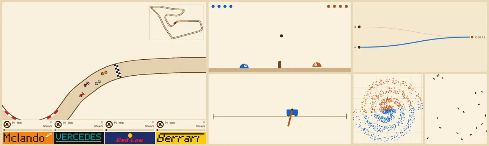

# turbo-neat



**turbo-neat** is a hardware-accelerated implementation of the 2002 paper [NEAT](http://nn.cs.utexas.edu/downloads/papers/stanley.ec02.pdf) (NeuroEvolution of Augmenting Topologies) in JAX.

Inspired by compute constraints faced at that time, NEAT is an evolutionary training algorithm that evolves a population of tiny neural networks by perturbing weights, changing activations, and adding and removing neurons.

## Installation
To install python dependencies with uv, run:
```bash
./install.sh
```
This will detect if a NVIDIA GPU is on your machine and install the JAX CUDA extras if they are needed.

## Quickstart

To evolve networks for your own environment you define three things: the environment, a config, and how a genome is scored. turbo-neat jits and vmaps the rest over the whole population.

### 1. Define an environment

An environment is any object with the familiar `reset` and `step`, over a batch of episodes played side by side. The state can be any pytree with an `obs` field. [EvoJAX](https://github.com/google/evojax)'s environments already have this shape (see `examples/cartpole.py` and `examples/boids.py`).

```python
from dataclasses import dataclass

import jax
import jax.numpy as jnp


@jax.tree_util.register_dataclass
@dataclass(frozen=True)
class State:
    obs: jax.Array  # what the networks see: (episodes, obs_size)
    pos: jax.Array
    target: jax.Array


class Seek:
    """Steer a point along a line to a random target."""

    def reset(self, keys: jax.Array) -> State:
        # one key per episode
        target = jax.vmap(lambda k: jax.random.uniform(k, minval=-1, maxval=1))(keys)
        pos = jnp.zeros_like(target)
        return State(obs=jnp.stack([pos, target], -1), pos=pos, target=target)

    def step(self, state: State, action: jax.Array):
        # action: (episodes, output_size), straight from the networks
        pos = state.pos + 0.1 * action[:, 0]
        reward = -jnp.abs(state.target - pos)
        done = jnp.zeros_like(pos, dtype=bool)
        obs = jnp.stack([pos, state.target], -1)
        return State(obs=obs, pos=pos, target=state.target), reward, done
```

For games where several genomes play together, an environment has `num_players` and `step_mp` instead of `step` (see `MultiPlayerEnvironment` in `neat/fitness.py`, `examples/slimevolley.py` and `examples/f1tenth.py`).

### 2. Configure NEAT

A `NEATConfig` has three parts: the shape of a genome, how genomes mutate, and how they are selected and grouped into species. Every example has a tuned config to start from; `neat/config.py` lists the rest of the options.

```python
import neat.activations as act
from neat.config import GenomeConfig, MutationConfig, NEATConfig, SelectionConfig
from neat.species import make_improvement_stagnation_fn

config = NEATConfig(
    genome_config=GenomeConfig(
        input_size=2,
        output_size=1,
        initial_capacity=50,  # nodes per genome; grows when it fills up
        init_weight_mean=0.0,
        init_weight_std=1.0,
        activation_fns=[act.iden, act.tanh, act.relu],
        input_activation_ids=[0, 0],  # indices into activation_fns
        output_activation_ids=[1],
        init_mode="full",  # start with every input connected to every output
    ),
    mutation_config=MutationConfig(
        add_connection_prob=0.1,
        disable_connection_prob=0.05,
        add_node_prob=0.05,
        disable_node_prob=0.03,
        mutate_weight_prob=0.8,
        mutate_weight_std=0.1,
        mutate_activation_prob=0.0,
        mutate_bias_prob=0.1,
        mutate_bias_std=0.1,
    ),
    selection_config=SelectionConfig(
        population_size=256,
        cutoff_pct=0.1,  # the worst 10% of each species don't breed
        compatibility_coefficients=(1.0, 0.5),  # species distance: topology, weights
        stagnation_fn=make_improvement_stagnation_fn(max_stagnated_steps=20),
    ),
)
```

### 3. Score and evolve

A fitness function scores every genome in the population at once. `make_fitness_fn` builds one from an environment. A test function, run every 10th generation by default, measures how good the best genomes really are on fresh episodes; it's optional.

```python
from neat.fitness import make_fitness_fn, make_test_fn
from neat.neat import NEAT
from neat.testing import make_top_k_test

env = Seek()
neat = NEAT(
    config,
    # each genome's fitness: its mean total reward over 4 episodes of 50 steps, all
    # genomes playing from the same 4 starts
    fitness_fn=make_fitness_fn(env, num_steps=50, num_episodes=4, replicate_rng=True),
    # the 10 fittest each play 100 new episodes
    test_fn=make_top_k_test(make_test_fn(env, num_steps=50, num_episodes=100)),
)
population = neat.run(seed=0, num_generations=50)
```

For multi-player environments, `make_mp_fitness_fn` pairs genomes off against each other. To train each genome's weights with gradients and leave the topology search to evolution, use `BackpropNEAT` with a function that returns the loss's gradients (see `examples/xor.py` and `examples/spiral.py`).

### 4. Use the result

`run` returns the final population. Its last scored generation is `prev_batched_genome`; `batched_genome` holds that generation's unscored offspring.

```python
from neat.genome import forward, prepare_for_inference

scored = population.prev_batched_genome
best = jax.tree.map(lambda x: x[jnp.argmax(scored.fitness)], scored)
best = prepare_for_inference(best)  # sort the graph for the forward pass
action = forward(
    best,
    jnp.array([0.0, 0.5]),  # observation
    activation_selector=config.genome_config.activation_selector,
)
```

To watch a run in the dashboard, pass `monitor=Monitor(project="seek")` to `NEAT` and an `episode_fn` to `run` that packs the environment's states into an `Episode`, drawn by a renderer you register in `monitor/renderers.py` (see [Monitoring runs](#monitoring-runs)).

## Monitoring runs
Training runs push metrics, an episode from each periodic test of the population, and every member of every generation (with its network, its reward in every episode it played for its fitness, and one of those episodes) to a small local dashboard. Members get names (`big-red-dog`: two adjectives for the individual, an animal for its species), a leaderboard, and a lineage view that traces any of them back through its parents. Episodes play in the browser, and when a run logs what its agents saw (`Episode(..., obs=...)`), the network beside an episode lights up with its activations frame by frame; click an agent to see its network:

```sh
uv run turbo-neat-monitor            # http://localhost:8008, runs stored in ./runs
uv run examples/boids.py --monitor   # in another shell
```

## Examples

<!-- TODO: one line on how the examples are laid out (each is a standalone script; `--help` lists its options) -->

### XOR (backprop NEAT)

```sh
uv run examples/xor.py
```

<!-- TODO: what the environment is, what to configure, expected results -->

### Two spirals (backprop NEAT)

```sh
uv run examples/spiral.py
```

<!-- TODO: what the environment is, what to configure, expected results -->

### Cart-pole swing-up

```sh
uv run examples/cartpole.py
uv run examples/cartpole.py --harder
```

<!-- TODO: what the environment is, what to configure, expected results -->

### Boids

```sh
uv run examples/boids.py
```

<!-- TODO: what the environment is, what to configure, expected results -->

### SlimeVolley (self-play)

```sh
uv run examples/slimevolley.py
```

<!-- TODO: what the environment is, what to configure, expected results -->

### F1TENTH racing (self-play)

```sh
uv run examples/f1tenth.py
uv run examples/f1tenth.py --cars 6
```

<!-- TODO: what the environment is, what to configure (--cars, --map, --test, ...), expected results -->

## Contributing

<!-- TODO -->

## Further Reading
- *Neural Network Evolution Playground with Backprop NEAT*, David Ha: https://blog.otoro.net/2016/05/07/backprop-neat/
- *Evolving Neural Networks through
Augmenting Topologies* (NEAT Paper): http://nn.cs.utexas.edu/downloads/papers/stanley.ec02.pdf
